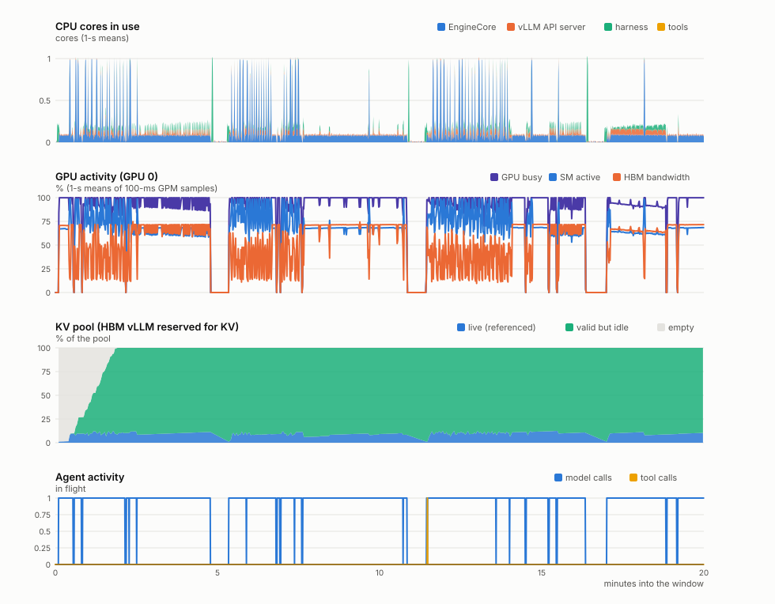
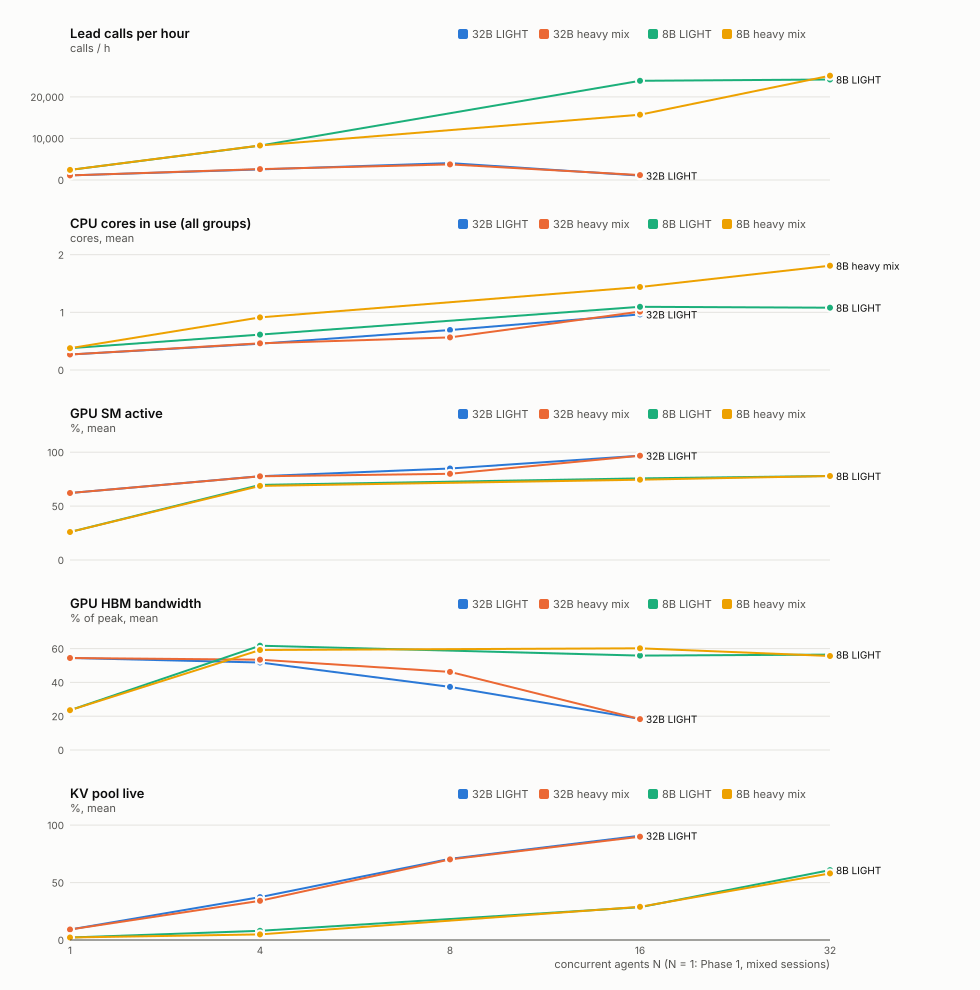

# 12 · Hardware utilization: does the CPU, the GPU, memory or the interconnect limit the s15 harness?

> **Status:** complete. Four 2-GPU H200 jobs (QoS standard), 2026-10-02 21:59 → 10-03 10:43:
> - 115550: Phase 0-1;
> - 115553: Phase 2;
> - 115554: knock-downs and co-location;
> - 115555: TP=2 / NVLink, its knock-down and CPU KV offload.
>
> In all: 34 levels in 12 cells, plus the 3-arm sampler A/B; 1,532 harness sessions and 133,144 model
> calls; 12.6 h of 2-GPU jobs = 25 H200 GPU-hours. Of the sessions, 685 ended normally, 504 at the
> harness's 100-call turn cap, and 343 were cut off at a window's end.
>
> **Question (user, 2026-10-02):** recent papers say the CPU might be the bottleneck of agent systems;
> our profiling says tool calls take under 1 % of the latency. Measure, on live runs only, the mean /
> median / peak utilization of CPU, GPU, host DRAM, HBM (separating what vLLM reserves from what is
> genuinely used) and the PCIe / NVLink (NVSwitch) links.
>
> **Models / hardware:** Qwen3-32B and Qwen3-8B (bf16, thinking off, `--max-model-len 40960`) on vLLM 0.29.0,
> H200 nodes (2-GPU jobs, 12 cores per GPU = the node's 96 cores / 8 GPUs), TP=1 and TP=2.
>
> **Follow-up (2026-10-03/04):** a re-analysis of the existing data (`hw_analyze.py phases`, tables T7-T8)
> splits the GPU counters by decode / prefill (§3.2) and corrects what the EngineCore thread's 0.83 cores
> are (§3.3). A fifth job (116695, 2026-10-04 02:27-03:23, cells s1 / s2) sampled that thread's stack (T9):
> it spins launching the next step's kernels, a step ahead of the GPU (§3.8).
>
> **Commits:** none yet (uncommitted).

**Contents** — Short answer · §1 Question and the papers' claims · §2 Method · §3 Results · §4 Conclusions ·
§5 Caveats · §6 Reproduction · Data inventory

## Short answer

- **On this harness the CPU is not the bottleneck at any load we could create; the GPU is.** In every
  configuration, throughput stops growing because of the GPU, never the host:
  - the configurations: Qwen3-32B and Qwen3-8B, 1 to 32 concurrent agents, typical sessions or test suites
    and repository-wide greps;
  - the busiest host used 1.8 cores on average (6.3 at the 1-s peak) of the 12 this GPU's share of the
    node offers;
  - the engine had a GPU step running for all but 0.0-0.1 % of every model call;
  - CPU pressure stayed under 1 %;
  - the GPU's limit is its HBM: decode bandwidth up to 8 agents, then the KV capacity, at which point the
    32B thrashes and its throughput drops 4×. Decode keeps the tensor cores at 5-30 % (prefill 55-83 %):
    each weight read from HBM serves only one token per agent (§3.2).
- **Taking cores away proves it.** Throughput is unchanged with:
  - eight agents (test suites included) on 1 core instead of 7;
  - vLLM's whole host side (API server + EngineCore) for 16 agents on 1 core instead of 4.

  Only latency moves: tool calls are 50 % slower on 1 agent core, and calls carry +30 ms of front end with
  vLLM on 1 core.
- **"Tools < 1 %" holds for the 32B, but the CPU's real share hides inside "model time".** Two other
  findings sit next to it:
  - Heavy tools with a fast model take 24-42 % of session time (Qwen3-8B, N = 1-4). They do so by
    *waiting*, not computing: the 17-s test suite uses 0.32 cores, and the 27-43-s greps over NFS use 0.04.
  - Every model call re-sends, re-parses and re-tokenises the whole conversation on the CPU. That costs
    about 3.5 ms per 1,000 prompt tokens: 3 % of a 32B call, 11 % of an 8B call, 20 % at 24-32k tokens.
    It is on the critical path, and the 05/06 numbers counted it as model time.
- **vLLM's single EngineCore thread looks close to its ceiling, but it is ahead of the GPU, not behind.**
  It reads 0.83 of a core for the 32B at 16 agents, yet its scheduling takes about 1 ms per step (0.3 % of
  that time). The busy time sits inside the 1.2-s re-prefill steps, where the thread spins launching the
  next step's kernels, a whole step ahead of the GPU (§3.8). Its real work is 1.7-4.6 ms per step (8B), so
  the GPU would have to get about 4-7× faster per step before this thread limits it. It is still the first
  CPU part that would (§3.3).
- **HBM: vLLM holds 92 %, and what is genuinely used grows with the agents.**
  - One 32B agent uses about 70 GiB of the 130 GiB vLLM holds: weights 61, live KV 6-9, activations ≤ 1.5.
  - The rest of the KV pool fills with valid but idle cached prefixes, 56 GiB on average. vLLM's own usage
    metric reports those as free.
  - At 16 agents the pool is 91 % live.
- **Host DRAM is not a concern either.** Each agent's harness is about 50-60 MB, so 32 agents fit in about
  2 GiB (plus about 3 GiB for vLLM's host processes).
- **Links are nearly idle unless KV is offloaded.**
  - PCIe at TP=1 carries 0.01-0.05 GB/s of 55 GB/s.
  - NVLink at TP=2 carries 2-11 GB/s per GPU of 478 GB/s per direction: under 5 % even in its busiest
    second.
  - TP=2's value is HBM: KV capacity triples, 24 agents run without thrashing, and calls are 1.7-1.9×
    faster.
  - Only CPU KV offload uses a link and host memory for real: 5 GB/s of PCIe on average (30 GB/s peaks,
    54 %) and 130 GiB of pinned host DRAM. In exchange, throughput triples at 16 agents (1,062 → 3,142
    lead calls/h).

## §1 Question and the papers' claims

Our 05/06 results measure *time on the agent's critical path* (06 census: 173k tool calls, 0.09 % of
1,042 h of wall time). They never measured hardware utilization, they counted vLLM's own host-side (CPU)
work as "model time", and they were mostly single sessions. The papers' CPU claims are about many
concurrent agents, heavy tools, and starved or shared host cores. Each claim below was checked against the
paper's text; the last column is the cell that tests it here.

| claim | source | tested by |
|---|---|---|
| Tool processing on the CPU takes up to 88 % of latency; throughput saturates at batch 128 from core over-subscription (tools CPU-heavy by design: exact kNN retrieval, LexRank) | Raj et al., arXiv 2511.00739 v3 | P2b / P2c heavy mix, K1 |
| Host CPU 6-31 % on average but bursts to ~100 % at stage boundaries; GPU SM activity < 55 %; involuntary context switches 71 → 660 /s from 1 → 32 agents | Yang et al., arXiv 2608.04458 | 10 Hz per-core bursts, GPM SM %, context switches vs N |
| Tool waits leave the GPU idle up to 54.5 % of the time | Kim et al., arXiv 2506.04301 | GPU activity by agent state (P1, P2) |
| A CPU-starved host leaves (multi-GPU) vLLM idle; enough cores cut TTFT 1.36-5.4× | Chung et al., arXiv 2603.22774 | K2 (TP=1 and TP=2) |
| Co-located CPU load inflates serving TTFT (up to 139×) | Blink 2604.07609, CoTail 2609.05425 | K3, shared vs pinned cores |
| Memory, not CPU, limits agent concurrency; sandbox CPU 7-13 % of a core | AgentCgroup 2602.09345, DSec 2609.22978, Aries 2607.29069 | DRAM per agent, HBM KV vs N |
| CPU:GPU ratio heading to 1:1 | Intel / AMD / Arm statements, 2026 (no published method) | cores per GPU at GPU saturation (T4) |

A free pilot from 11's own 1 Hz traces (`11_multiuser_kv/data/multiuser_live/cells/*/server/*/scrape.jsonl`,
Qwen3-32B on one H200, 16 CPUs per cell, think time on) already showed total CPU under 1 of 16 cores at
every load, with one component near saturation: vLLM's EngineCore thread, 0.77 of a core at N ≥ 16. Its
session column missed short-lived tool processes, which is one reason for the new sampler.

## §2 Method

**Runs.** Live only: the s15 harness (`research/common/profile_run.py` through 11's `mu_sweep.py` /
`mu_session.py`), a real vLLM 0.29 server per cell, real tasks:
- LIGHT: 11's 4-turn EXPLAIN / MODIFY sessions on the 10 real codebases (requests, click, jinja2, rich,
  httpx, yaml, packaging, tqdm, typer, the s15 harness).
- HEAVY: 06's HTEST (fix two bugs in a sandbox copy of the s10 task system, rerunning its pytest file, then
  the lessons' 517-test suite, ~45 s of one core) and HSEARCH (three exact-count questions answered with
  grep / find over the 7.6 GB site-packages).
- Agents run closed loop with think time 0 (an agent fleet). N agents = N concurrent sessions, each in its
  own lane (repository copy on node-local disk).

**Instruments.** `hw_sampler.py` (one per server lifetime, on its own core), `hw_scheduler.py` (11's
MUScheduler + an HBM record), the harness traces and request captures. All join on CLOCK_MONOTONIC.

| resource | metric | source | rate |
|---|---|---|---|
| CPU | cores per group: vLLM API server, EngineCore, TP workers, other vLLM; driver, harness sessions, their tools; sampler | /proc/PID/stat; tree totals (utime+stime+cutime+cstime of live members) so reaped short-lived tools count | 2 Hz |
| CPU | per-core busy of the cell's own cores: completeness and bursts (share of 100-ms samples with the agent cores ≥ 90 % busy) | /proc/stat | 10 Hz |
| CPU | hottest vLLM threads and their run-queue delay, context switches, job cgroup PSI | /proc/PID/task/*/{stat,schedstat}, cgroup | 2 Hz |
| GPU | kernel-active %, memory-controller %, SM active, SM occupancy, tensor active, HBM bandwidth % | NVML + GPM | 10 Hz |
| GPU | power, energy, clocks, throttle reasons | NVML | 1 Hz |
| HBM | static split: weights, CUDA graphs, KV pool, other vLLM reserve, unallocated | vLLM log + NVML | once |
| HBM | dynamic split: live KV (referenced), valid-but-idle KV (cached-free), empty KV, live tokens, activation memory actually used (TP=1) | HWScheduler pool walk | 0.5 Hz |
| host DRAM | RSS per group, PSS of vLLM, job cgroup current / peak / anon / page cache, PSI | /proc, cgroup | 2 Hz |
| PCIe | TX / RX bytes per GPU | NVML field counters (and GPM rates) | 1 Hz (10 Hz) |
| NVLink | TX / RX bytes per GPU (the GPU's traffic into the NVSwitch fabric) | NVML NVLink throughput counters (and GPM) | 1 Hz (10 Hz) |
| serving | running / waiting, KV usage, prefix hits, token counters, preemptions | vLLM /metrics | 1 Hz |
| serving | per model call: front-end in, engine with a GPU step running, engine without one, front-end out | request capture × scheduler arrival / finish / step stamps | per call |
| EngineCore thread (s1 / s2 only) | its Python stack and CPU time | `hw_scheduler.py` with `HW_STACK_MS=20` (in-process: py-spy is not installed, and the login node forbids ptrace attach) | 50 Hz |

**Cells.**

| phase | cell | model, TP | levels |
|---|---|---|---|
| 0 | probe | both GPUs | capabilities; counters calibrated against known loads (PCIe copies, NVLink peer copy and NCCL all-reduce, HBM allocation, CPU burn + 600 short-lived processes) |
| 0 | ab | 32B | sampler overhead: 10 min of 11's pilot8 replay, sampler off / on / off |
| 1 | p1a, p1b | 32B, 8B | one agent: 8 LIGHT sessions, HTEST ×3, HSEARCH ×3 (after a smoke session gate) |
| 2 | p2a / p2b | 32B | LIGHT / HEAVY mix at N = 4, 8, 16 (30-min windows after a 5-min warm-up) |
| 2 | p2c | 8B | LIGHT and HEAVY mix at N = 4, 16, 32 |
| 3 | k1h / k1l | 32B | agent-CPU knock-down: HEAVY / LIGHT at N = 8, harness + tools limited to 7, 4, 2, 1 cores; vLLM stays on its own 4 |
| 3 | k2 | 8B | serving-CPU knock-down: LIGHT N = 16, vLLM limited to 4, 2, 1 cores; the agents keep their own 7 |
| 3 | k3 | 32B | co-location: HEAVY N = 16 with vLLM and agents sharing 11 cores |
| 3 | t2, k2t | 32B TP=2 | NVLink / NVSwitch: LIGHT at N = 1, 8, 24; and N = 8 with vLLM on 4, 2 cores |
| 3 | o1 | 32B | PCIe + host DRAM: LIGHT N = 16 with 128 GiB native CPU KV offload |
| follow-up | s1 / s2 | 32B / 8B | EngineCore stack sampling: LIGHT at N = 4, 16 (32B) and 4, 32 (8B), 20-min windows (§3.8) |

## §3 Results

### §3.1 What can be measured on these nodes, and does measuring cost anything? (Phase 0)

Probe of job 115550 on alphagpu22 (`data/probe/115550.json`, `115550_nvml.json`):

| item | finding |
|---|---|
| host | 2 × Intel Xeon Platinum 8568Y+ (48 cores each, no SMT), 2 NUMA nodes, 600 MiB L3, 2 TB DRAM; shared with other jobs (cgroup v2 cpuset per job) |
| GPUs | H200, 143,771 MiB each, PCIe Gen5 x16; the job's two GPUs are NV18 to each other: 18 NVLinks × 26.56 GB/s = 478 GB/s per direction per GPU, through 4 NVSwitches |
| GPU counters a user can read | NVML utilisation and memory; **GPM** (SM active, SM occupancy, tensor active, HBM bandwidth %, PCIe and NVLink MiB/s) at 10 Hz; PCIe byte counters; per-link NVLink byte counters. Not available: DCGM (not installed), Nsight Systems GPU metrics ("insufficient privilege") |
| host counters | `perf` is installed but `perf_event_paranoid` = 4, RAPL energy is root-only, resctrl is not mounted: **host DRAM bandwidth and CPU energy cannot be measured**; DRAM is reported as capacity (RSS, page cache, cgroup) |
| CPU accounting check | known CPU burn + 600 short-lived processes: measured 7.44 s vs rusage 7.46 s (−0.3 %); a pinned 2-s burn reads 1.94 s on its core; a reaped child's I/O reaches the parent's /proc io |
| HBM | an 8 GiB allocation shows as 8.0 GiB more NVML-used memory (J1 probe, `data/probe/115553.json`) |
| PCIe | pinned copies reach **51.5 GB/s** each way (Gen5 x16). GPM's PCIe rate is right at the sampler's 100-ms cadence: integrated over J0's server start-up it gives 59.3 GiB against the 61.0 GiB of weights loaded. NVML's PCIe byte counter is a 32-bit counter of raw link bytes: it wraps at 4 GiB and runs ~8 % above payload (20 GiB of copies read 1.68 GB = 1.078 × 20 GiB mod 2³²), so it is only a cross-check |
| NVLink | a 20 GiB peer copy GPU0 → GPU1 runs at **281.6 GB/s** and the per-link NVML counters read 21,474,835,456 bytes sent and 21,474,837,504 received (exact); an NCCL all-reduce on the pair peaks at **327 GB/s** bus bandwidth (the TP traffic pattern; the reference peak below). GPM's NVLink rate reads 0 on these nodes and is not used |
| GPM SM / tensor / HBM-bandwidth % | validated at the sampler's 100-ms cadence (J2 probe, `data/probe/115554.json`): a bf16 matmul reads SM 97 %, tensor 94 %, HBM bandwidth 18 % (compute-bound); a device-to-device copy reads SM 100 %, tensor 0 %, HBM bandwidth 89 % (memory-bound). Sampled every ~20 ms (J1's first check) GPM reads nonsense |
| PCIe, re-checked | J2: 55.4 GB/s each way; GPM's rate and the wrap-corrected counter both read 7-9 % above the payload (they count link bytes), so PCIe numbers below are link bytes |

Sampler overhead, `cells/ab` (the same 10 minutes of 11's pilot8 replay, 680 identical calls per arm, sampler off / on / off):

| arm | output tok/s | median call latency |
|---|---|---|
| off (1) | 98.11 | 1.575 s |
| sampler on | 98.11 | 1.573 s |
| off (2) | 98.09 | 1.586 s |

Paired per-call latency ratio on/off = 1.0006 and 1.0001, against an off/off noise floor of 1.0003; the
sampler itself uses 0.068 cores. Measuring changes nothing measurable.

### §3.2 One agent at a time (Phase 1, N = 1)

Each model ran the same 14 sessions back to back: 8 LIGHT (4 turns each), 3 HTEST, 3 HSEARCH
(`cells/p1a`, `cells/p1b`, job 115550). Agent-time shares are of the sessions' own wall time; the
utilisation numbers are over the whole level (75 min for Qwen3-32B, 29 min for Qwen3-8B).

| | Qwen3-32B | Qwen3-8B |
|---|---|---|
| session time: model calls / tools / harness | **96.8 % / 0.8 % / 2.4 %** | 51.9 % / **42.3 %** / 5.9 % |
| CPU cores, mean / p95 / peak of 1-s means (12 cores per GPU) | 0.27 / 0.86 / 1.46 | 0.38 / 0.70 / 1.39 |
| — vLLM (API server + EngineCore), mean | 0.15 | 0.14 |
| — harness / tools, mean | 0.03 / 0.02 | 0.05 / 0.12 |
| CPU while a tool runs (all groups / tools) | 0.33 / 0.23 cores | 0.34 / 0.26 cores |
| EngineCore main thread, p95 / peak | 0.72 / 1.02 cores | 0.26 / 0.46 cores |
| GPU busy while a model call is in flight | 96 % (SM 70 %, tensor 15 %, HBM bandwidth 61 %) | 84 % (SM 57 %, tensor 6 %, HBM bandwidth 51 %) |
| GPU busy while a tool runs | 12 % | 4 % |
| inside a model call: front end in / GPU step running / engine gaps / front end out | 3.0 / 96.4 / 0.5 / 0.1 % | 10.6 / 87.8 / 1.2 / 0.3 % |
| front-end time per call, mean | 88 ms | 69 ms |
| HBM: vLLM holds / genuinely used* | 130 / ≈ 70 GiB | 129 / ≈ 20 GiB |
| — KV live (referenced), mean / max | 5.8 / 8.6 GiB (9 % of the pool) | 2.4 / 4.5 GiB (2 %) |
| — KV valid but idle (cached prefixes), mean | 56.3 GiB | 38.9 GiB |
| — activation memory actually used, max | 1.45 GiB | 0.75 GiB |
| PCIe, both directions, mean (GPM link bytes) | 0.04 GB/s (0.08 % of 55 GB/s) | 0.02 GB/s (0.04 %) |
| host DRAM: job anon / page cache | 3.2 / 78 GiB (job-wide) | 6.1 / 78 GiB |
| GPU power, mean / max | 516 / 709 W | 278 / 682 W |

\* weights + CUDA graphs + live KV + activations actually used (+ about 0.5-1 GiB of CUDA context).



What it shows:

- **The 32B reproduces "< 1 %" and the CPU is idle.** Tools take 0.8 % of the sessions, the whole host
  uses about a quarter of a core of the twelve this GPU's share of the node offers, and the GPU is busy 96 % of
  every model call. The scarce resource is the GPU's HBM bandwidth during decode (61 % mean, 72 % p95,
  with tensor cores at 15 %): decode is memory-bound.
- **A fast model moves the share, not the load, and the slow tools wait rather than compute.** On
  Qwen3-8B the same sessions spend 42 % of their time in tools, because model calls are 3× shorter while
  the two slow tools are not: HTEST's full test suite takes 16-17 s but keeps only **0.32 cores** busy
  (about 5.5 CPU-seconds per run), and HSEARCH's greps take 27-43 s at **0.04 cores**, reading 0.33 GB:
  they wait on the network file system's metadata for 63,000 files. The CPU stays at 0.38 cores on
  average; the GPU waits too (4 % busy while tools run). Long tools are latency, not CPU load. The 8B also loops: with
  thinking off it repeats the same `find`/`grep` until the harness's 100-call turn cap (6 of 8 LIGHT
  sessions end at the budget, as in 06), so its LIGHT sessions are a high-call-rate stress, not productive
  work.
- **The serving front end is CPU work on the critical path, and it grows with the context.** Every call
  re-sends and re-processes the whole conversation: the client SDK serialises it, HTTP carries it, vLLM
  parses it, renders the chat template and tokenises it, although the prefix cache spares the GPU.
  Front-end time per call rises linearly, about 3.5 ms per 1,000 prompt tokens:

  | prompt tokens | < 4k | 4-8k | 8-16k | 16-24k | 24-32k |
  |---|---|---|---|---|---|
  | Qwen3-32B, median front-end ms | 17 | 24 | 46 | 82 | 103 |
  | Qwen3-8B, median front-end ms | 16 | 29 | 60 | 84 | 113 |

  It is 3 % of a 32B call but 11 % of an 8B call (about 20 % at 24-32k tokens). About half is before
  vLLM starts rendering (SDK, HTTP, request parsing: 61 s of 120 s for the 32B, 52 of 81 s for the 8B),
  half rendering and tokenisation. This is the CPU cost that "model time" hid in 05/06.
- **HBM: one agent uses a small part of what vLLM holds; the rest fills with valid but idle cache.**
  vLLM takes 92 % of HBM at start. For one 32B agent, about 70 GiB is in use (61 GiB of weights, 6-9 GiB
  of live KV, up to 1.5 GiB of activations); for the 8B about 20 GiB. The KV pool does not stay empty: it
  fills with cached prefixes of finished calls (56 GiB on average for the 32B, 89 % of the pool), which
  are valid and reusable but referenced by nothing; vLLM's own `kv_cache_usage_perc` counts them as free.
- **Links are idle.** PCIe carries 0.02-0.04 GB/s (token ids in, sampled tokens out); NVLink carries
  nothing at TP=1.

**Why SM active is high and tensor active low.** The two counters measure different things:
- **SM active** counts an SM as active when it holds at least one warp, even a warp stalled waiting on
  HBM. The probe's memory copy reads 100 % with no arithmetic at all.
- **Tensor active** counts the cycles in which the tensor-core pipe issues; 100 % is about peak matmul
  throughput.

Splitting each 100-ms GPM sample by what the GPU ran in it (scheduler steps, `data/tables/T7_gpu_phases.md`;
the rest of the samples are idle or mixed):

| what the GPU ran | share of samples | SM active | tensor active | HBM bandwidth |
|---|---|---|---|---|
| 32B, one agent: decode only (batch 1) | 71 % | 68 % | **5 %** | **70 %** |
| 32B, one agent: steps with prefill | 12 % | 90 % | **75 %** | 14 % |
| 8B, one agent: decode only | 31 % | 61 % | 5 % | 57 % |
| *probe: bf16 matmul* | | 97 % | 94 % | 18 % |
| *probe: device-to-device copy* | | 100 % | 0 % | 89 % |

- **Decode looks like the copy, prefill like the matmul.** A decode step reads every weight once and uses
  it for 2 FLOPs per sequence in the batch, about B FLOP/byte for a batch of B, while the H200 needs about
  206 FLOP/byte (989 TFLOPS / 4.8 TB/s) to be compute-bound. A batch-1 32B decode step takes 20.5 ms
  (median, scheduler log): 65 GB of weights in 20.5 ms is 3.2 TB/s, 67 % of 4.8 TB/s (measured: 70 %).
- **The useful math in decode is about 0.3 % of peak** (49 tokens/s × 66 GFLOP per token). Tensor active
  reads 5 %, about 16× more, which is consistent with tensor-core instructions working on tiles of at least
  16 rows while batch-1 decode fills one; this cannot be checked per kernel here (no profiler counters).
- **Prefill** computes thousands of tokens per weight read: 55-83 % tensor at every level.
- **More agents raise tensor activity in two ways** (T7): decode batches grow (32B decode: 5 % at batch 1,
  11 % at 3.7, 16 % at 7.5, 24 % at 11; 8B: 30 % at 30), and prefill takes more of the time (32B at
  N = 16: 96 % of the samples are re-prefill at 83 % tensor, which is why the thrashing level reads tensor
  80 % with HBM bandwidth 18 %; that is the GPU recomputing evicted KV, not useful extra work).

### §3.3 Many agents on one GPU (Phase 2, N = 4-32, closed loop, no think time)

Each level is a 30-minute window after a 5-minute warm-up on one H200 (`cells/p2a`, `p2b`, `p2c`, job 115553;
N = 1 is the Phase 1 run of the same model, with LIGHT and heavy sessions mixed). CPU columns are cores
(means of 1-s means), out of the 12 this GPU's share of the node offers; GPU columns are GPM means; "front
end" and "engine gaps" are shares of model-call time (§3.2).

| model, workload | N | lead calls/h | output tok/s | tool share | CPU total, mean / peak | vLLM | harness | tools | EngineCore thread | GPU busy % | SM % | tensor % | HBM BW % | KV live | front end | engine gaps |
|---|---|---|---|---|---|---|---|---|---|---|---|---|---|---|---|---|
| 32B (P1, mixed) | 1 | 1,098 | 36 | 0.8 % | 0.27 / 1.46 | 0.15 | 0.03 | 0.02 | 0.12 | 86 | 62 | 14 | 54 | 9 % | 3.0 % | 0.5 % |
| 32B LIGHT | 4 | 2,541 | 94 | 0.0 % | 0.46 / 1.83 | 0.25 | 0.08 | 0.05 | 0.20 | 100 | 78 | 33 | 52 | 37 % | 2.5 % | 0.0 % |
| 32B LIGHT | 8 | **4,070** | 97 | 0.0 % | 0.69 / 2.39 | 0.42 | 0.12 | 0.08 | 0.34 | 100 | 85 | 53 | 37 | 71 % | 4.0 % | 0.0 % |
| 32B LIGHT | 16 | 1,062 | 22 | 0.0 % | 0.96 / 1.69 | 0.86 | 0.01 | 0.03 | **0.83** | 100 | 97 | 80 | 18 | **91 %** | 2.0 % | 0.0 % |
| 32B heavy mix | 4 | 2,630 | 96 | 3.4 % | 0.46 / 1.97 | 0.25 | 0.06 | 0.07 | 0.20 | 100 | 78 | 31 | 53 | 34 % | 3.3 % | 0.0 % |
| 32B heavy mix | 8 | 3,763 | 132 | 0.7 % | 0.57 / 2.08 | 0.31 | 0.11 | 0.07 | 0.24 | 100 | 80 | 41 | 46 | 70 % | 2.3 % | 0.0 % |
| 32B heavy mix | 16 | 1,170 | 22 | 1.4 % | 1.01 / 3.11 | 0.86 | 0.02 | 0.08 | 0.83 | 100 | 97 | 81 | 18 | 90 % | 1.9 % | 0.0 % |
| 8B (P1, mixed) | 1 | 2,426 | 63 | 42.3 % | 0.38 / 1.39 | 0.14 | 0.05 | 0.12 | 0.11 | 39 | 26 | 3 | 24 | 2 % | 10.6 % | 1.2 % |
| 8B LIGHT | 4 | 8,275 | 379 | 0.5 % | 0.61 / 2.21 | 0.33 | 0.15 | 0.05 | 0.21 | 99 | 70 | 13 | 62 | 8 % | 5.2 % | 0.0 % |
| 8B LIGHT | 16 | 23,879 | 702 | 0.4 % | 1.10 / 3.30 | 0.46 | 0.46 | 0.10 | 0.17 | 100 | 76 | 32 | 56 | 29 % | 4.6 % | 0.0 % |
| 8B LIGHT | 32 | 24,189 | 858 | 0.2 % | 1.08 / 3.17 | 0.42 | 0.47 | 0.11 | 0.13 | 100 | 78 | 40 | 56 | 61 % | 2.5 % | 0.0 % |
| 8B heavy mix | 4 | 8,291 | 288 | 24.3 % | 0.91 / 3.12 | 0.37 | 0.17 | 0.30 | 0.24 | 94 | 69 | 12 | 59 | 5 % | 7.7 % | 0.1 % |
| 8B heavy mix | 16 | 15,711 | 685 | 12.2 % | 1.44 / 4.46 | 0.36 | 0.32 | 0.68 | 0.16 | 99 | 75 | 28 | 60 | 29 % | 3.1 % | 0.0 % |
| 8B heavy mix | 32 | **25,113** | 811 | 5.4 % | **1.81 / 6.29** | 0.45 | 0.53 | 0.76 | 0.14 | 99 | 78 | 40 | 56 | 58 % | 2.7 % | 0.0 % |



What it shows:

- **The GPU saturates first, every time; the CPU never comes close.** The busiest host in the whole sweep
  (32 agents of the 8B with test suites and repository greps) uses 1.8 cores on average and 6.3 at its
  1-s peak: 15 % and 52 % of this GPU's 12 cores. Throughput stops growing where the GPU stops having room:
  - 32B: at N = 8 (4,070 lead calls/h). At N = 16 the **KV pool** is full (90-91 % live), evicted
    contexts are re-prefilled (tensor 80 %, HBM bandwidth 18 %), output drops to 22 tok/s and throughput to a
    quarter: HBM *capacity* is the binding resource, as in 11.
  - 8B: at N = 16-32 (24-25k lead calls/h, 0.8k output tok/s). The pool is only 29-61 % live; the GPU is
    100 % busy on batched decode over long contexts (calls slow from 0.6 to 2.2 s).
- **The CPU never starves the GPU.** Once a call reaches the engine, a GPU step is running for all but
  0.0-0.1 % of it at every N ≥ 4 ("engine gaps"); the GPU part is 92-98 % of a call's time, the rest is the
  front end. CPU pressure (PSI) stays below 1 %. The front end (SDK, HTTP,
  template, tokenisation) is 2-8 % of a call: it adds latency per call, it does not limit throughput.
- **The one CPU part that climbs: vLLM's EngineCore thread, and most of its climb is waiting.** All of the
  engine process's CPU is on this one thread (`VLLM::EngineCor`). It reads 0.83 of a core on average (p95
  1.0) for the 32B at N = 16, against 0.13-0.24 for the 8B. Its scheduling work does not explain this
  (table below, `data/tables/T8_engine_thread.md`).
- **Heavy tools change the agents' time, not the machine's load.** On the 8B, tools take 24 % of session
  time at N = 4 and 5 % at N = 32: as model calls slow down under load, the same tools weigh less. Tools cost
  0.3-0.8 cores: they mostly wait (§3.2).
- **Per unit of work the CPU is cheap.** The harness spends about 0.07-0.09 CPU-seconds per lead call
  (JSON, SDK, context bookkeeping); vLLM's host side 2-4 CPU-seconds per 1,000 output tokens at N = 1.

**Where the EngineCore thread's CPU goes.** MUScheduler stamps every step: `schedule()`, the launch, and
`update_from_output()`. Against the thread's CPU (2-Hz samples of its own counters):

| level | thread busy (cores) | steps/s | thread CPU per step | `schedule()` + `update()` per step | busy inside a > 1-s step (share of samples ≥ 0.95) | busy, short steps only |
|---|---|---|---|---|---|---|
| 32B, N = 4 | 0.20 | 26 | 7.6 ms | 0.22 ms | 0.74 (68 %) | 0.06 |
| 32B, N = 8 | 0.34 | 13 | 26 ms | 0.45 ms | 0.76 (69 %) | 0.06 |
| 32B, N = 16 | **0.83** | 2.0 | 405 ms | **1.1 ms** | **0.92 (86 %)** | 0.04 |
| 8B, N = 4 | 0.21 | 122 | 1.8 ms | 0.17 ms | (no such step) | 0.22 |
| 8B, N = 32 | 0.13 | 30 | 4.5 ms | 0.91 ms | (no such step) | 0.13 |

(32B: p2a LIGHT; 8B: p2c LIGHT. "Inside a > 1-s step" = 0.5-s samples entirely inside one step whose
launch-to-result time exceeds 1 s; "short steps only" = samples spanning at least 5 steps, all under 100 ms.)

- **Scheduling is not what grows.** At 32B N = 16, `schedule()` and `update_from_output()` take 1.1 ms per
  step at 2 steps/s: 0.3 % of the thread's time. They grow with the batch (0.17 → 0.91 ms on the 8B from 4
  to 32 agents) but stay small.
- **The busy time sits inside long GPU steps.** A thrashing 32B re-prefills in 8,192-token chunks that take
  about 1.2 s from launch to result. Inside such a step, after scheduling it in about 1-2 ms, the thread
  reads 0.92 of a core, and at least 95 % in 86 % of the samples; between short decode steps it reads 0.04.
  Every 32B TP=1 level shows the same split (0.68-0.92 inside long steps, 0.04-0.12 between them, T8). The
  8B's prefill chunks finish about 4× sooner and never show it, although the 8B prefills as many tokens
  per second.
- **The thread is not waiting there: it is launching the next step's kernels, at full speed** (stack
  samples, §3.8), a step ahead of the GPU. vLLM's end-of-step wait sleeps (`copy_event`, created with
  `blocking=True`, in `vllm/v1/worker/gpu/async_utils.py`), which is why decode reads 0.04-0.08.
- **What is left is small next to a step.** The 8B's thread needs 1.7-4.6 ms of CPU per step (scheduling
  9-20 % of it) against steps of 7-34 ms, so the GPU would have to get about 4-7× faster per step before
  this thread limits throughput (with async scheduling the CPU prepares one step while the GPU runs the
  previous one). One thread cannot use a second core, so it is still the first CPU part that would.
- **At TP=2 the thread reads 0.84-0.99 all the time** when it has the cores, short steps included (t2, and
  k2t at 4 cores, in T8): there it polls the workers' message queue, the polling §3.5 measured.

### §3.4 Taking cores away (Phase 3 knock-downs, job 115554)

Utilisation alone cannot say whether a resource limits throughput; removing it can. Each knock-down keeps
everything else fixed (same model, same N, same session order, prefix cache reset between levels) and
changes only the cores one side may use (`taskset`); 20-minute windows (30 for k3).

**Serving side (k2): Qwen3-8B, LIGHT, N = 16, vLLM's API server + EngineCore limited to 4, 2 or 1 cores;
the agents keep their own 7 cores.**
This is the case the CPU-starvation papers describe (a host that cannot keep the GPU fed).

| vLLM cores | output tok/s | median call | front end per call | EngineCore / API thread waiting for a CPU | engine gaps | GPU busy |
|---|---|---|---|---|---|---|
| 4 | 731 | 1.28 s | 81 ms | 0.0 % / 0.0 % | 0.0 % | 100 % |
| 2 | 730 | 1.22 s | 100 ms | 1.4 % / 0.3 % | 0.0 % | 100 % |
| 1 | 727 | 1.21 s | 112 ms | 9.7 % / 8.8 % | 0.0 % | 99 % |

One core runs the whole serving front of 16 agents with no loss of throughput (−0.5 %) and no GPU idling;
the only cost is about 30 ms more front-end time per call, from the two threads queueing for the one core.
(Lead calls per hour, 19-24k, varies more than output between these levels because the 8B's looping
sessions vary; output tokens are the throughput measure here.)

**Serving side at TP=2 (k2t, job 115555): Qwen3-32B over two H200s, LIGHT, N = 8, vLLM on 8, 4, 2 cores.**
Chung et al.'s case: a multi-GPU server whose host processes (API server, EngineCore, one worker per GPU)
compete for few cores.

| vLLM cores | output tok/s | median call | front end | vLLM CPU used | EngineCore / worker / API thread waiting for a CPU | CPU pressure (PSI some) | GPU busy |
|---|---|---|---|---|---|---|---|
| 8 (t2) | 229 | 1.43 s | 162 ms | 3.12 cores | 0 / 0 / 0 % | 0.1 % | 99 / 98 % |
| 4 | 235 | 1.51 s | 156 ms | 3.10 cores | 0.1 / 0 / 0.8 % | 0.5 % | 99 / 98 % |
| 2 | 238 | 1.31 s | 215 ms | 2.00 cores | **50 / 12 / 9 %** | **53 %** | 99 / 99 % |

At TP=2, vLLM's host side burns about 3 cores during calls at any load (each TP worker spins about a core,
the EngineCore about one more; §3.5). Squeezed onto 2 cores, the engine thread waits for a CPU half the
time and the job's CPU pressure reads 53 %, which any monitoring would flag as a severe CPU bottleneck; yet
output is unchanged and both GPUs stay 99 % busy. The cores were going to polling. The only cost is about
50 ms more front-end time per call. At agent request rates (2 calls/s here) the starvation Chung et al.
measure (TP 4-8, 5-16 requests/s, 1.7k-114k-token prompts) does not occur.

**Agent side (k1h): Qwen3-32B, heavy mix (test suites, repository greps), N = 8, harness + tools limited
to 7, 4, 2 or 1 cores; vLLM stays on its own 4 cores throughout.** Every session and tool inherits the
driver's core set (`taskset`), so at the last level 8 agents and all their test suites share one core.

| agent cores | lead calls/h | output tok/s | tool share | bash call, mean | agent cores busy, mean / peak (cores) | 100-ms samples with the core ≥ 90 % busy |
|---|---|---|---|---|---|---|
| 7 | 3,495 | 125 | 2.6 % | 1.8 s | 0.14 / 1.84 | 0 % |
| 4 | 4,855 | 94 | 3.7 % | 2.5 s | 0.20 / 1.82 | 0 % |
| 2 | 4,381 | 129 | 2.6 % | 3.4 s | 0.14 / 1.09 | 0.1 % |
| 1 | 4,700 | 134 | 5.0 % | 2.7 s | 0.21 / 1.00 | 9.5 % |

The same knock-down on LIGHT sessions (k1l; 32B, N = 8; tools are `read_file` 1-2 ms, `edit_file` 1 ms):

| agent cores | lead calls/h | output tok/s | tool share | agent cores busy, mean / peak | samples with the core ≥ 90 % busy |
|---|---|---|---|---|---|
| 7 | 4,347 | 109 | 0.02 % | 0.13 / 1.64 | 0 % |
| 4 | 3,640 | 72 | 0.02 % | 0.10 / 1.49 | 0 % |
| 2 | 4,148 | 90 | 0.02 % | 0.09 / 1.34 | 0.1 % |
| 1 | 4,154 | 129 | 0.02 % | 0.12 / 1.00 | 6.6 % |

Eight agents running test suites and greps need 0.14-0.21 cores on average (LIGHT sessions 0.09-0.13). On a single core throughput
does not drop (the ±20 % between levels is the session mix: the 32B, too, sometimes loops to the call cap);
what changes is tool latency: bash calls take about 50 % longer, and the core is saturated in bursts
(9.5 % of 100-ms samples), the "stage-boundary bursts" of Yang et al. at 1 core for 8 agents.

**Co-location (k3): Qwen3-32B, heavy mix, N = 16, vLLM and the agents sharing the same 11 cores,** against
the pinned layout of p2b N = 16 (4 vLLM + 7 agent cores):

| layout | lead calls/h | output tok/s | median call | EngineCore thread busy / waiting for a CPU | front end |
|---|---|---|---|---|---|
| pinned (p2b N = 16) | 1,170 | 22 | 34.2 s | 0.83 / 0.0 % | 905 ms |
| shared (k3) | 1,060 | 19 | 39.3 s | 0.85 / 0.0 % | 935 ms |

The EngineCore thread never waited for a CPU even with test suites on its cores: the tools use too little
CPU to interfere. Both runs are in the KV-thrashing regime (N = 16), where call times vary by tens of
seconds, so the 10 % difference in throughput is within that regime's noise; the interference the
co-location papers report (Blink, CoTail) needs CPU-hungry neighbours, which these tools are not.

### §3.5 Links: PCIe, NVLink / NVSwitch, and CPU KV offload

**PCIe at TP=1 is idle.** Every TP=1 level, 1 to 32 agents, moves 0.01-0.03 GB/s each way: token ids in,
sampled tokens out, metrics. That is under 0.1 % of the 55 GB/s the probe measured, also at its 1-s peak.

**NVLink at TP=2 (t2, job 115555): Qwen3-32B over the two H200s, LIGHT, 8 vLLM cores.**

| N | lead calls/h | output tok/s | median call | KV live (pool 777k tokens) | NVLink TX per GPU, mean / 1-s peak | % of 478 GB/s per direction, mean / peak | GPU busy / SM / tensor / HBM BW | vLLM CPU |
|---|---|---|---|---|---|---|---|---|
| 1 | 1,943 | 61 | 0.74 s | 3 % | 2.0 / 19.4 GB/s | 0.4 / 4.1 % | 82 / 50 / 11 / 46 % | 2.70 cores |
| 8 | 6,994 | 229 | 1.43 s | 23 % | 7.3 / 18.9 GB/s | 1.5 / 4.0 % | 99 / 76 / 39 / 43 % | 3.12 cores |
| 24 | 8,656 | 227 | 4.20 s | 72 % | 10.7 / 18.7 GB/s | 2.2 / 3.9 % | 99 / 84 / 58 / 31 % | 3.14 cores |

- The two GPUs exchange the per-layer all-reduce traffic: 2-11 GB/s on average each way, never more than
  21.6 GB/s in any second. That is under 7 % of what NCCL achieves on this pair (329 GB/s) and under 5 % of
  the link (18 NVLinks × 26.6 GB/s per direction). Receive runs 16-20 % above send; the two GPUs are
  symmetric.
- Splitting the model is worth it here, but for HBM, not for compute. Each GPU reads half the weights, so
  calls are 1.7-1.9× faster than at TP=1. Each GPU also keeps 95 GiB for KV instead of 63, and half of
  each token's KV, so the pool holds 777k tokens, 3× TP=1. At N = 24, TP=2 is still not thrashing (72 %
  live, 8,656 lead calls/h); TP=1 thrashed at N = 16.
- vLLM's host side at TP=2 costs about 3 cores during calls, even for one agent, against 0.12-0.86 at
  TP=1: the two workers and the EngineCore poll. It falls to 0.4 cores when nothing is in flight, and it
  needs only 2 cores to keep both GPUs busy (§3.4, k2t).

**CPU KV offload (o1, job 115555): Qwen3-32B TP=1, LIGHT, N = 16, `--kv-offloading-size 128
--kv-offloading-backend native`,** against the same level without it (p2a N = 16):

| | lead calls/h | output tok/s | median call | GPU busy / SM / tensor / HBM BW | PCIe RX (host → GPU), mean / 1-s peak | PCIe TX, mean / peak | host DRAM held by vLLM |
|---|---|---|---|---|---|---|---|
| no offload | 1,062 | 22 | 36.3 s | 100 / 97 / 80 / 18 % | 0.02 / 0.03 GB/s | 0.01 / 0.02 GB/s | 2.4 GiB |
| 128 GiB CPU tier | **3,142** | **93** | 11.8 s | 85 / 73 / 47 / 32 % | **5.2 / 29.8 GB/s** | 1.2 / 4.1 GB/s | **130 GiB** (pinned) |

This is the one configuration in which a link and host memory do real work. Evicted KV is copied out
to host DRAM and back in instead of being re-prefilled:
- Throughput triples (11's replay predicted 2.8×), and tensor activity drops from 80 % to 47 %: less
  recompute.
- PCIe carries 9 % of its capacity on average and 54 % in its busiest second.
- The engine holds 130 GiB of pinned host DRAM, about half of a GPU's share of the node's 2 TB.

The PCIe counter check: NVML's 32-bit counter, wrap-corrected at 1 Hz, misses most of the inbound traffic
here (2.4 TB counted against 9.3 TB from GPM), because a 30 GB/s second wraps it seven times. That is
why GPM is the primary PCIe source.

### §3.6 HBM: what vLLM reserves vs what is genuinely in use

vLLM takes 92 % of HBM at start-up, about 130 of the 140 GiB, whatever the load. Inside that, the
pool-walk splits the KV pool every 2 s into **live** blocks, **valid but idle** blocks and **empty**
blocks:
- live: referenced by a running or waiting request;
- valid but idle: cached prefixes of finished calls, reusable but referenced by nothing; vLLM's
  `kv_cache_usage_perc` counts them as free;
- empty: never filled, or invalidated.

GiB per GPU; KV columns are mean / max over the window.

| cell | weights | CUDA graphs | KV pool | other reserve* | unallocated | KV live | KV valid but idle | KV empty | activations used, max | genuinely used, mean** |
|---|---|---|---|---|---|---|---|---|---|---|
| 32B, N = 1 | 61.0 | 0.8 | 63.0 | 5.2 | 10.3 | 5.8 / 8.6 | 56.3 / 62.9 | 0.9 / 62.4 | 1.45 | ≈ 70 (54 %) |
| 32B, N = 16 | 61.0 | 0.8 | 63.0 | 5.2 | 10.3 | 57.3 / 63.0 | 5.8 / 28.0 | 0.0 | 1.45 | ≈ 121 (93 %) |
| 32B, N = 16, CPU offload | 61.0 | 0.8 | 63.0 | 5.5 | 10.0 | 59.7 / 63.0 | 3.3 / 13.0 | 0.0 | 1.45 | ≈ 123 (95 %) |
| 8B, N = 1 | 15.3 | 0.5 | 109.1 | 4.5 | 11.0 | 2.4 / 4.5 | 38.9 / 88.6 | 67.9 / 108.7 | 0.75 | ≈ 20 (15 %) |
| 8B, N = 32 | 15.3 | 0.5 | 110.8 | 4.0 | 9.9 | 67.4 / 89.1 | 43.4 / 62.7 | 0.0 | 0.75 | ≈ 85 (65 %) |
| 32B TP=2, N = 1 (per GPU) | 30.6 | 0.5 | 94.8 | 6.1 | 8.4 | 2.9 / 4.7 | 91.9 / 94.5 | 0.0 | n/a | ≈ 35 (26 %) |
| 32B TP=2, N = 24 (per GPU) | 30.6 | 0.5 | 94.8 | 6.1 | 8.4 | 68.3 / 81.9 | 26.5 / 48.1 | 0.0 | n/a | ≈ 101 (77 %) |

\* NVML-used memory minus weights, graphs and KV pool: the activation workspace vLLM reserved at
profiling, CUDA context, cuBLAS / NCCL buffers. \*\* weights + graphs + live KV + activations actually used
+ about 1 GiB of context, as a share of what vLLM holds.

- **A few agents use a fraction of what vLLM reserves.** For one 32B agent it is about 54 %, mostly
  weights; one 8B agent about 15 %, one TP=2 agent about 26 % per GPU.
- **The pool does not stay empty: it fills with valid but idle prefixes.** They make up 56 GiB on
  average for the 32B at N = 1 and 92 GiB per GPU at TP=2. This memory is the KV that 11 showed is evicted
  first when other users need room.
- **At the thrashing point the whole pool is live** (32B, N = 16: 57 of 63 GiB on average, all 63 at peak),
  and only then is HBM capacity the binding resource.
- **Activations are small.** The prefill peaks this hook can see (TP=1, outside CUDA graphs) reach
  0.75-1.45 GiB. Decode runs in CUDA-graph pools (0.5-0.8 GiB) that sit inside "CUDA graphs".

### §3.7 Host DRAM

- **The harness is light.** Each agent's harness process holds about 50-60 MB on average (anon + shmem;
  up to 0.3 GiB while it handles a large file), and a pytest run adds up to 0.25 GiB. At 32 agents the
  harness processes total 1.7-2.0 GiB.
- **vLLM's host processes hold about 3 GiB** (API server 1.0, EngineCore 2.0-2.4) without offload, and
  130 GiB with the 128 GiB CPU KV tier.
- **The page cache is the largest user.** The job cgroup's page cache holds the model weights read from
  the NFS cache (78 GiB for both models) and the site-packages HSEARCH greps. It counts against the job's
  memory limit but is reclaimable.
- **Host DRAM bandwidth could not be measured** (§3.1); the only host-memory traffic we can bound is what
  crosses PCIe: 0.03 GB/s without offload and 5-6 GB/s with it.

### §3.8 Follow-up: where the EngineCore thread spends its time (cells s1 / s2, job 116695)

§3.3 places the thread's busy time inside long prefill steps but cannot name the call. py-spy is not
installed and the login node denies ptrace attach (Yama `ptrace_scope` = 2), so `hw_scheduler.py` samples
the thread from inside the engine process when `HW_STACK_MS` is set: every 20 ms, its Python stack (a
thread inside a C call shows the Python line that made it) and the CPU its pthread clock used since the
last sample.

- **s1:** Qwen3-32B, LIGHT, N = 4 (long prefills now and then) and N = 16 (thrashing: mostly 1.2-s prefill
  steps), 20-minute windows.
- **s2:** Qwen3-8B, LIGHT, N = 4 and 32: short steps only, to see what the 1.7-4.6 ms of real work per step
  is.

Job 116695 ran both on alphagpu19 (2026-10-04 02:27-03:23): about 150,000 samples per server, no
sampler errors. The levels reproduce T7-T8 for the same loads (32B N = 16: 0.89 cores, 0.94 inside long
steps, against 0.83 / 0.92 in p2a). Where the thread is, as a share of samples
(`data/tables/T9_engine_stacks.md`):

| samples | thread busy | GEMM launches | attention-op launches | end-of-step wait | other (scheduling, input preparation, sampling) |
|---|---|---|---|---|---|
| 32B N = 16, inside 1.2-s prefill steps (50,099) | 0.93 | 81 % | 8 % | 7 % | 3 % |
| 32B N = 4, inside long steps (11,787) | 0.69 | 52 % | 12 % | 32 % | 4 % |
| 32B N = 4, short (decode) steps (40,552) | 0.07 | 0 % | 1 % | 92 % | 6 % |
| 8B N = 4, short steps (55,639) | 0.23 | 0 % | 2 % | 77 % | 21 % |
| 8B N = 32, short steps (48,284) | 0.14 | 1 % | 3 % | 85 % | 11 % |

- **The end-of-step wait sleeps, everywhere.** `get_output` waits on `copy_event`, created with
  `blocking=True` (`vllm/v1/worker/gpu/async_utils.py:134, 168`). In every row the thread's CPU equals
  the share of time it spends outside that wait (0.69 vs 0.68, 0.93 vs 0.93, 0.07 vs 0.08, 0.23 vs 0.23,
  0.14 vs 0.15), and at 32B N = 4 the 32 % of long-step samples in the wait carry 1 % of the CPU.
- **Inside long prefill steps the thread is launching kernels, at full speed.** 89 % of its samples sit in
  kernel-launch calls of the compiled model: the four cuBLAS matrix multiplies of each layer (QKV,
  attention output, MLP gate+up and down: lines 1230, 1183, 1199 and 1212 of Inductor's generated code)
  and the two attention ops. A launch normally returns in microseconds. The forward being launched is a
  later step's: vLLM launches a step before it waits for the previous one (`step_with_batch_queue`, two
  steps in flight), and the samples fall inside an earlier step's launch-to-result window, which only
  starts once that step's own launch has returned.
- **Most likely the driver's launch queue is full.** Each compiled layer launches 8 kernels (4 GEMMs, 4
  Triton kernels) plus the 2 attention ops: about 640 launches per 32B prefill step (64 layers) and 360
  per 8B step (36 layers), and a 32B GEMM over 8,192 tokens runs for milliseconds. With a second step's
  launches queued behind the first, further launches block until the GPU retires kernels, and the thread
  stays on the CPU while they block (0.93 busy). The 8B never shows it, although it runs the same code. The
  queue depth itself was not measured.
- **So the 0.83-0.93 cores at the thrashing point are the CPU a whole step ahead of the GPU:** a symptom
  of long GPU steps, not of CPU demand, and a faster core would not change throughput. The spin does hold
  one core, which would matter only with CPU-hungry neighbours on the same cores (k3).
- **Decode's real work has no hotspot.** Outside the wait the 8B's thread spreads its 1.8-4.9 ms per step
  over input preparation (`copy_to_uva`, `build_slot_mappings_by_layer`, `async_tensor_h2d`), sampling,
  request bookkeeping and the scheduler, each at most 2 % of samples. `schedule()` + `update_from_output()`
  are 0.17-0.98 ms of it (T8).
- **Measurement notes.** T9's CPU column charges each 20-ms interval's CPU to the stack at its end. That is
  right in long steps, where the thread stays put, but in short steps it moves the work done before a wait
  onto the wait (75-86 % of decode CPU appears "in" the wait); the time shares above have no such bias.
  The sampler never waited for the GIL (0 % of samples): the engine thread releases it in these calls.

## §4 Conclusions

| claim | what this harness shows on live runs |
|---|---|
| Tool processing on the CPU dominates latency; core over-subscription saturates throughput (Raj et al.) | Tools take 0.8 % of a 32B session and 24-42 % of an 8B session with heavy tools, but those tools wait (test suite 0.32 cores, NFS greps 0.04 cores). Eight agents with test suites run on one core without losing throughput. Their tools are latency-bound, not CPU-bound; the paper's tools (exact kNN over 115 GB, LexRank) were CPU-bound by design. |
| Host CPU bursts to ~100 % at stage boundaries; involuntary context switches rise to 660/s (Yang et al.) | Bursts exist only when the agents are squeezed onto 1 core (core ≥ 90 % busy in 7-10 % of 100-ms samples). Involuntary switches reach about 35/s at 32 agents (about 70/s on 1 core). Otherwise the cell's 12 cores are 2-15 % busy on average. |
| Tool waits leave the GPU idle up to 54.5 % of the time (Kim et al.) | True for one agent with a fast model: the 8B GPU is idle 61 % of its N = 1 run, 35 % of it while tools run. From 4 agents up the GPU is busy 94-100 %: other agents fill the gaps. |
| A CPU-starved host leaves vLLM's GPUs idle (Chung et al.) | Not at agent request rates. One core serves 16 agents at TP=1 and two cores serve 8 at TP=2, with no throughput loss and no GPU gaps, even at 53 % CPU pressure. The cost is +30-50 ms of front end per call. |
| Co-located CPU load inflates serving latency (Blink, CoTail) | No interference measured: tools sharing vLLM's cores never made the EngineCore thread wait. These tools are not CPU-hungry neighbours. |
| Memory, not CPU, limits agent concurrency (AgentCgroup, DSec, Aries) | Yes, but GPU memory, not host memory. KV capacity sets the turning point (32B: 8 agents at TP=1; beyond 24 at TP=2). Host DRAM per agent is about 60 MB. CPU KV offload trades 130 GiB of host DRAM and 5 GB/s of PCIe for 3× the throughput past the turning point. |
| CPU:GPU ratio heading to 1:1 (industry) | For this harness at the GPU's saturation point, one H200 needed about 1-2 cores for 16-32 agents (vLLM included), or about 3 polling cores at TP=2 (2 suffice). The node offers 12 per GPU. |

What the CPU *does* cost is latency, on three paths:
- **The serving front end re-sends and re-processes the whole conversation on every call:** about 3.5 ms
  per 1,000 prompt tokens, 3-11 % of a call, 20 % for the 8B at long contexts. It is the CPU share that
  "model time" hid in 05/06. Fixing it would mean sending only the new turn, or an incremental
  tokeniser / template; prefix caching only saves the GPU's half.
- **vLLM's EngineCore is a single thread, and its busy figure overstates its load.** It reads 0.83 of a core
  at 16 agents on the 32B, but its scheduling takes about 1 ms per step; the rest is the thread spinning
  in kernel launches during 1.2-s prefill steps, a step ahead of the GPU (§3.8). Its real work, 1.7-4.6 ms
  per step on the 8B against steps
  of 7-34 ms, leaves room for a GPU about 4-7× faster per step. Because one thread cannot use a second
  core, it is still the first CPU part that would cap a faster GPU or a busier scheduler.
- **CPU utilisation and pressure are poor bottleneck signals in this stack.** At TP=2, polling shows 3 busy
  cores and, squeezed, 53 % pressure, with zero effect on throughput. Only an intervention (taking the
  cores away) tells spin from need.

Where this does *not* generalise:
- the tools here are local and light-to-medium (no compilation, no exact retrieval, no browsers);
- one node type (Xeon 8568Y+, H200) and vLLM 0.29;
- two models with thinking off. The 8B loops, which makes its sessions a high-call-rate stress rather than
  productive work.

Workloads with CPU-bound tools (builds, exact vector search, many agents per core) would move the
picture, as Raj et al. show; the knock-down method here is the way to find out.

## §5 Caveats

- **Shared nodes.** The nodes are shared with other jobs, so LLC, memory-bandwidth and NFS contention can
  reach us; only our own cores (an exclusive cpuset) are attributed. HSEARCH's tool time depends on the
  NFS cache state: cold 27-43 s, warm 1-5 s.
- **Unmeasured.** Host DRAM bandwidth and CPU energy can't be measured on these nodes (`perf_event_paranoid`
  = 4, RAPL root-only, no resctrl).
- **CPU accounting fix.** J0, J1 and J2's first cells ran the sampler before the double-count fix; their
  tool CPU comes from the per-core counters (exact for the agent side, which has exclusive cores). The
  harness, driver and vLLM groups were never affected.
- **The models loop.** Both run with thinking off, and both sometimes end a turn at the harness's 100-call
  cap. The 8B does so in most LIGHT sessions, the 32B in some. Lead calls per hour therefore varies ±20 %
  between paired levels; output tokens per second is steadier.
- **Window and noise.** Phase 2 and 3 levels are 20-30-minute windows of one run each. Differences under
  about 20 % in calls per hour are within the session-mix noise. The knock-down conclusions rest on flat
  output and unchanged GPU activity, not on small differences.
- **No think time.** Agents run closed loop (an agent fleet). With human think time (11) the same GPU
  holds more users before the turning point, and the CPU is even less loaded.
- **Activations.** The scheduler hook sees allocator stats only at TP=1, and only outside CUDA graphs.

## §6 Reproduction

```bash
python research/12_hw_utilization/hw_workloads.py build          # data/sessions.jsonl, data/conditions.json
python research/12_hw_utilization/test_hw.py                      # unit + two end-to-end tests (no GPU)
sbatch --export=NONE research/12_hw_utilization/hw.sbatch probe ab,p1a p1b                 # J0
sbatch --export=NONE research/12_hw_utilization/hw.sbatch - p2a,p2b p2c                    # J1
sbatch --export=NONE research/12_hw_utilization/hw.sbatch - k1h,k1l k2,k3                  # J2
sbatch --export=NONE --mem=320G research/12_hw_utilization/hw.sbatch t2,k2t o1 -          # J3
sbatch --export=NONE research/12_hw_utilization/hw_cpu.sbatch tables                       # T1-T6
python research/12_hw_utilization/hw_analyze.py phases                                     # T7-T9 (~2 min)
sbatch --export=NONE --time=02:00:00 research/12_hw_utilization/hw.sbatch - s1 s2          # J4 = 116695, §3.8
```

Resubmitting the same arguments resumes: finished cells and levels are skipped, an interrupted windowed
level is moved to `aborted_<level>_<time>/` and rerun whole. Phase 1 levels resume session by session.

## Files

| path | purpose |
|---|---|
| `hw_sampler.py` | the sampler (fast / host / slow streams + meta) |
| `hw_scheduler.py` | vLLM scheduler class: 11's MUScheduler + an HBM record per pool walk; with `HW_STACK_MS`, EngineCore stack samples |
| `hw_probe.py` | Phase 0: capabilities and calibrations |
| `hw_workloads.py` | session specs (data/sessions.jsonl), conditions (data/conditions.json, read by 11's driver through `MU_EXTRA_CONDITIONS`), cells and CPU layouts |
| `hw_pipeline.sh`, `hw.sbatch` | one 2-GPU job: probe, A/B, cells |
| `hw_analyze.py`, `hw_cpu.sbatch` | smoke gate, probe / A/B summaries, tables T1-T6; `phases`: T7-T9 |
| `hw_figures.py` | static SVG figures (load curve, level timelines) |
| `fake_vllm.py`, `test_hw.py` | tests without a GPU (fake model server, unit tests, driver and pipeline end to end) |

Changes outside this folder: `11_multiuser_kv/mu_workloads.py` (opt-in `MU_EXTRA_CONDITIONS` hook,
`client_extra`) and `11_multiuser_kv/mu_sweep.py` (lane model from the condition). Without the variable
11 behaves as before; its tests pass.

## Changes during the run

- **2026-10-02, J0:** the probe segfaulted in `nvmlDeviceGetGpuFabricInfo` (pynvml passes the struct by
  value); fixed with `ctypes.byref`. Its GPU calibrations then ran in every later job instead (J1 onward).
- **2026-10-03, J1 probe:** GPM read implausible values when sampled every ~20 ms; calibration now samples
  every 100 ms (the sampler's own cadence, which was right all along). NVML's PCIe byte counter turned out to
  be a 32-bit raw-link counter: PCIe now comes from GPM, the counter is a wrap-corrected cross-check.
- **2026-10-03 04:10, sampler fix:** the CPU tree accounting double-counted a child that exited in the same
  interval as its parent (pytest inside bash): one interval could show up to 165 phantom tool cores, and over
  the 8B heavy-mix windows the tool CPU was overstated about 1.8×. Fixed (the counts now go to the nearest
  live ancestor) with a regression test; J0, J1 and J2's first cells (k1h, k2 at 4 cores) ran the old code.
  For every level, tool CPU is now taken from the busy time of the cell's own agent cores (exclusive to the
  cell, so it cannot double count) minus harness and driver; the tree figure is kept as `tools_tree`. The
  "5.7-core test suite" of the first Phase 1 draft was this artifact: the suite uses 0.32 cores.
- **2026-10-03, follow-up:** two questions about §3.2-§3.3 led to `hw_analyze.py phases`. T7 (GPU counters by
  decode / prefill) and T8 (EngineCore thread vs. its scheduling work) re-read the existing data. T8
  showed that the earlier explanation of the thread's 0.83 cores ("scheduling work grows with the queue of
  re-prefills") was wrong: scheduling is about 0.3 % of it. Cells s1 / s2 and the opt-in stack sampler
  in `hw_scheduler.py` were added to find where the thread spends that time. Cells can now carry a
  `server_env` (`hw_workloads.py cell C --field server_env`), which the pipeline passes to `vllm serve`.
- **2026-10-04, J4 (116695):** s1 / s2 ran on alphagpu19 in 55 minutes. T9 first ranked stack locations by
  the CPU charged to them, which in decode put the CPU of the work before each wait onto the wait (the
  20-ms sampling period is longer than a step); it now reports where the thread is (share of samples) and
  keeps the charged CPU as a second column. The guess in §3.3 that the thread "polls the GPU" in a wait
  was wrong: it spins in kernel launches (§3.8).

## Data inventory

Everything below is under `data/` (333 MB, about 17,000 files; the largest file is 39 MB, the 8B sweep's
scheduler log). Each cell has the same layout:
- `server/<job>_<cell>_<time>/`, one per server lifetime:
  - `vllm.log`, `server_info.json` (pool size, versions, GPU), `markers.jsonl` (launch, healthy, level
    start / end);
  - `samp/` (sampler `fast`, `host`, `slow` streams as `.jsonl.xz`, plus `meta.json`);
  - `sched.jsonl.xz` (scheduler steps, requests, pool walks, HBM records).
- `levels/<level>/`, one per load level:
  - `runs/<session>/` (trace, inputs sidecar, request capture, meta, diff, console log);
  - `cell_log.jsonl`, `sweep.log`;
  - `WINDOW_DONE` (windowed levels) or `COMPLETE`.

| path | what | why it was run |
|---|---|---|
| `sessions.jsonl`, `conditions.json` | 1,038 session specs; the 38 conditions read by 11's driver (34 + the four s1 / s2 levels) | generated by `hw_workloads.py build` |
| `probe/115550.json`, `115550_nvml.json` | J0 node: environment only (the NVML step segfaulted, see Changes), NVML capabilities | Phase 0 |
| `probe/115553.json`, `115554.json`, `115555.json` | full probes of J1-J3's nodes: CPU accounting, HBM, GPM (valid from 115554 on), PCIe, NVLink, NCCL | every job calibrates its node first |
| `cells/ab/` | sampler off / on / off on 11's pilot8 replay (`off1/`, `on/`, `off2/` = `replay_calls.jsonl`) | sampler overhead |
| `cells/p1a/`, `cells/p1b/` | 32B / 8B, one agent: smoke session + 14 sessions | Phase 1 |
| `cells/p2a/`, `p2b/`, `p2c/` | 32B LIGHT and heavy mix at N = 4, 8, 16; 8B LIGHT and heavy mix at N = 4, 16, 32 | Phase 2 |
| `cells/k1h/`, `k1l/` | 32B heavy mix / LIGHT at N = 8 on 7, 4, 2, 1 agent cores | agent-CPU knock-down |
| `cells/k2/` | 8B LIGHT at N = 16 with vLLM on 4, 2, 1 cores (a server per level) | serving-CPU knock-down |
| `cells/k3/` | 32B heavy mix at N = 16, vLLM and agents on shared cores | co-location |
| `cells/t2/`, `k2t/` | 32B at TP=2: N = 1, 8, 24; N = 8 with vLLM on 4, 2 cores | NVLink / NVSwitch; serving-CPU knock-down at TP=2 |
| `cells/o1/` | 32B at N = 16 with a 128 GiB native CPU KV tier | PCIe and host DRAM |
| `cells/s1/`, `s2/` | 32B LIGHT at N = 4, 16; 8B LIGHT at N = 4, 32; `sched.jsonl.xz` also holds `stk` / `stkdef` records | §3.8 |
| `jobs/<job>.log`, `jobs/slurm-<job>.log` | pipeline log (levels, smoke checks, probe summary), Slurm output | |
| `tables/summary.json`, `tables/T1-T6_*.md` | every number in §3 (`hw_analyze.py tables`) | |
| `tables/T7_gpu_phases.md`, `T8_engine_thread.md`, `T9_engine_stacks.md` | GPU counters by decode / prefill; the EngineCore thread; its stacks (`hw_analyze.py phases`) | follow-up |
| `figures/load_curve.svg`, `figures/timeline_p1a_hw_p1a.svg` | §3.3 figure; a 20-minute timeline of the 32B single-agent run | |

No level was aborted or rerun. No session failed outside the expected ends: 685 ended `ok`, 504 at the
harness's call cap (`budget`), and 343 were cut off at a window's end (`terminated`).
